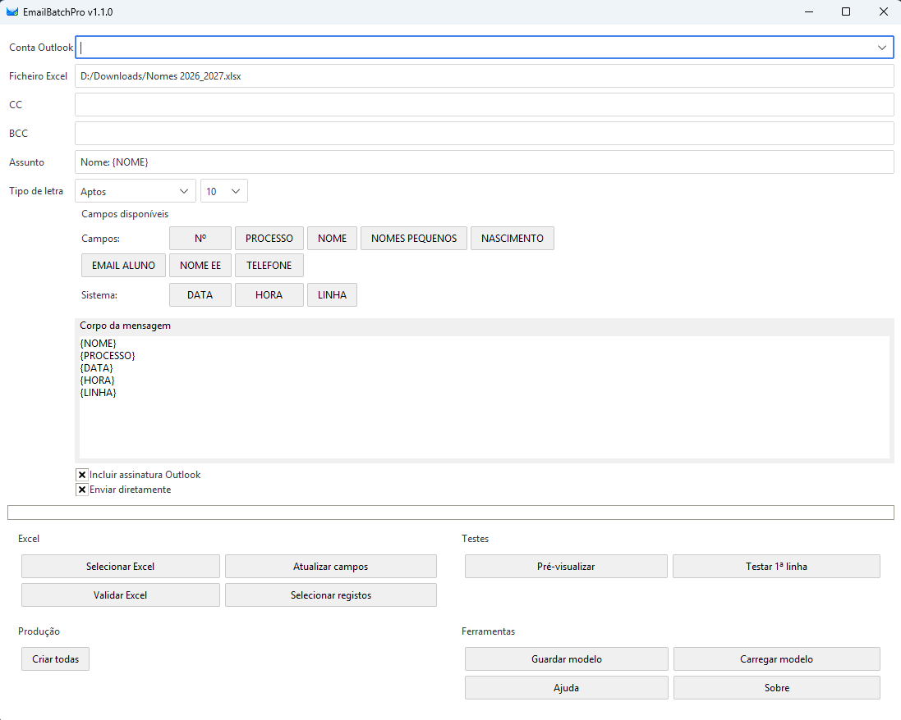
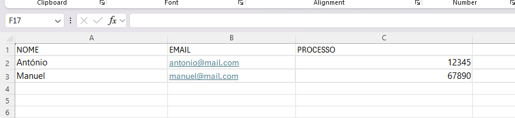
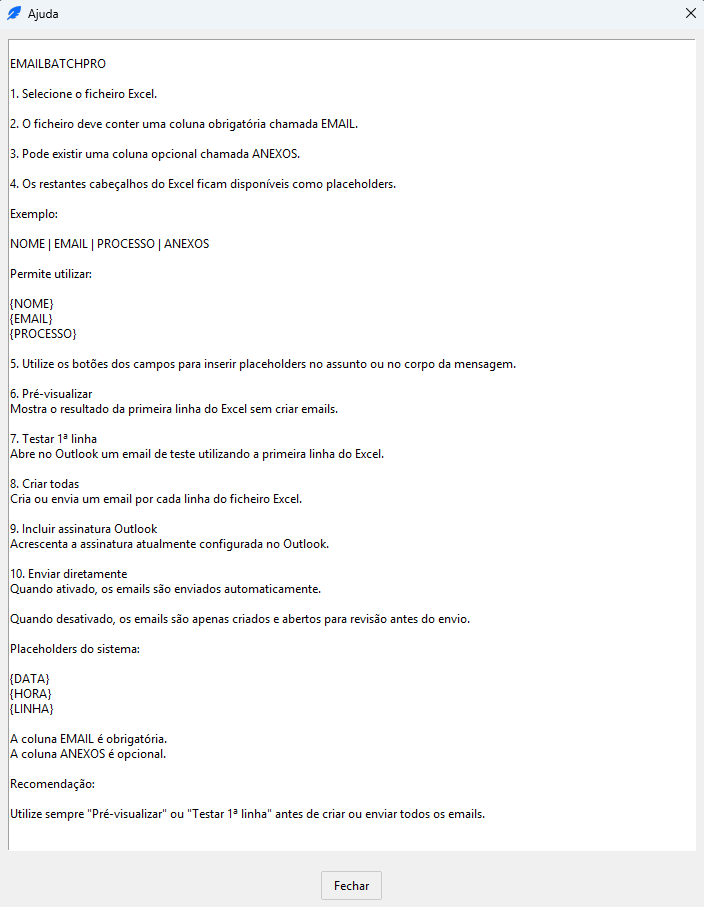

# EmailBatchPro

**Versão 1.0**

Ferramenta para criação e envio de emails personalizados em lote através do Microsoft Outlook.

## Funcionalidades

- Placeholders dinâmicos
- Anexos automáticos
- Assinatura Outlook
- Pré-visualização
- Modelos reutilizáveis
- Envio direto ou revisão manual
- Integração com Microsoft Outlook

## Requisitos

- Windows 10 ou superior
- Microsoft Outlook instalado e configurado com pelo menos uma conta de email

## Como funciona

1. Selecione o ficheiro Excel.
2. O Excel deve conter uma coluna obrigatória chamada EMAIL.
3. Pode existir uma coluna opcional chamada ANEXOS.
4. Utilize os placeholders disponíveis para personalizar o assunto e o corpo da mensagem.
5. Teste com "Pré-visualizar" ou "Testar 1ª linha".
6. Utilize "Criar todas" para processar todos os registos.

## Capturas de ecrã

### Janela principal

### Excel

### Output

### Sobre

### Ajuda

## Compatibilidade

✅ Microsoft Outlook clássico (desktop)

❌ Novo Outlook para Windows

## Download

➡️ A versão mais recente pode ser descarregada na secção **Releases** deste repositório.

## Licença

Este projeto é disponibilizado gratuitamente para utilização pessoal e educativa.

Todos os direitos reservados.

## Apoiar o projeto

Se o EmailBatchPro lhe for útil, pode oferecer um café:

☕ https://paypal.me/mmartins73
