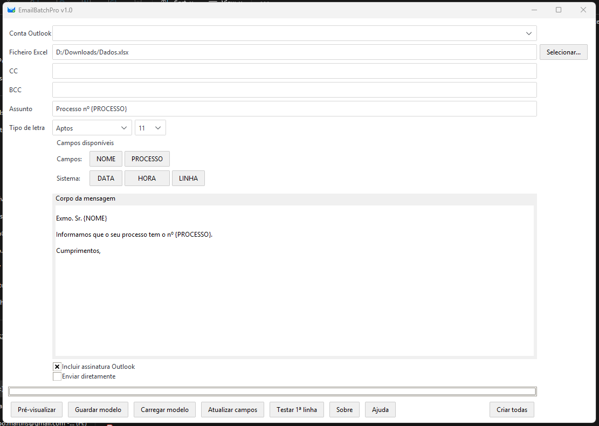
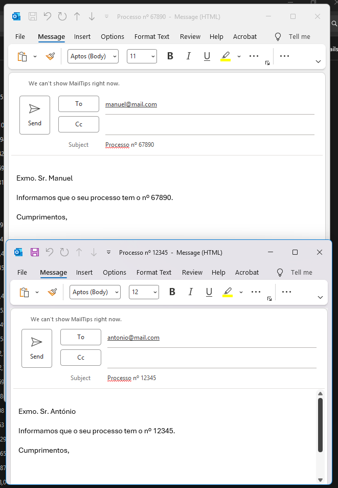
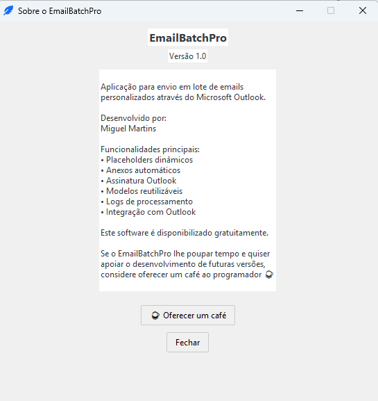

# EmailBatchPro

Ferramenta para criação e envio de emails personalizados em lote através do Microsoft Outlook.

## Funcionalidades

- Placeholders dinâmicos
- Anexos automáticos
- Assinatura Outlook
- Pré-visualização
- Modelos reutilizáveis
- Envio direto ou revisão manual
- Integração com Microsoft Outlook

## Requisitos

- Windows 10 ou superior
- Microsoft Outlook instalado

## Capturas de ecrã

### Janela principal

### Excel

### Output

### Ajuda

### Sobre

## Download

Disponível na secção Releases.

## Apoiar o projeto

Se o EmailBatchPro lhe for útil, pode oferecer um café:

☕ https://paypal.me/mmartins73
